# Library Borrowing Request System

## Project Description
This system records each request like student, book, and publication year and places it in a first-in, first-out queue so the oldest waiting request is processed first. Users can also search the records and sort them by name, title, request number, or year to review them. Sorting only reorders the displayed records, it never changes the order in which requests are processed.

## Objectives

- Implement two sorting algorithms manually, without Java's built-in sort methods.
- Use a Java `Queue` to enqueue, peek, display, and dequeue requests in FIFO order.
- Store request data in ArrayLists whose indexes stay synchronized.
- Apply methods, loops, conditionals, and input validation in a procedural design.
- Combine records, search, sorting, and queue operations in one working program.

## Use Cases and Features

The program is menu-driven. Each menu option and what it does:

| Option | Function | Description |
|:------:|----------|-------------|
| 1 | Register request | Stores student name, book title, and publication year (1000-2026). A request number is assigned automatically, starting at 1001. |
| 2 | Display all records | Lists every request with its status. |
| 3 | Search request | Finds a request by exact request number or by partial, case-insensitive student name. |
| 4 | Enqueue request | Adds a registered request to the waiting queue. Duplicates and unknown numbers are rejected. |
| 5 | Process next (dequeue) | Removes the front request from the queue and marks it Processed. |
| 6 | Peek next | Shows the front request without removing it. |
| 7 | Display queue | Shows the waiting requests from front to back. |
| 8 | Check if queue is empty | Reports whether the queue is empty, or how many requests are pending. |
| 9 | Bubble Sort | Sorts records by student name or book title (A-Z). |
| 10 | Insertion Sort | Sorts records by request number or publication year (ascending). |
| 0 | Exit | Ends the program. |

Each request has one of three statuses: **Registered**, then **Queued**, then **Processed**.

Error handling covers invalid menu choices, non-numeric input, years outside the allowed range, blank text, empty record lists, empty queues, missing records, and duplicate enqueue attempts. None of these terminate the program.

## Data Structure Explanation

**ArrayLists (record storage).** Each request is spread across five parallel ArrayLists. The value at index `i` in every list belongs to the same request.

| ArrayList | Type | Holds |
|-----------|------|-------|
| `requestIds` | `Integer` | Request number |
| `studentNames` | `String` | Student name |
| `bookTitles` | `String` | Requested book |
| `pubYears` | `Integer` | Publication year |
| `statuses` | `String` | Registered, Queued, or Processed |

A shared `swapRecords(i, j)` method swaps all five lists at the same time. Both sorting algorithms use it, so a record's fields can never become mismatched.

**Queue (processing order).** The waiting line is a `Queue<Integer>` backed by `LinkedList<Integer>`. It stores request numbers, not copies of records, in arrival order. Display and peek look up each queued number in the ArrayLists to show its details. Dequeue removes only the front number and marks that request Processed. Because the queue holds request numbers instead of list positions, sorting the ArrayLists does not affect it.

**Procedural design.** The program uses only the `main` method, static methods, static fields, and built-in Java collections. It defines no custom entity classes.

## Sorting Algorithm Explanation

| | Bubble Sort | Insertion Sort |
|---|---|---|
| **Sorts by** | Student name or book title (A-Z, ignoring case) | Request number or publication year (ascending) |
| **Method** | Compares adjacent records and swaps them if out of order, repeating until a pass makes no swaps | Takes each record and moves it backward until it sits in the correct place among the records before it |
| **Why it fits** | Simple and readable for sorting text fields in a small record set | Efficient on nearly sorted data, such as request numbers that are assigned in increasing order |
| **Time complexity** | O(n²) average and worst case; stops early when already sorted | O(n²) average and worst case; faster on nearly sorted lists |

In both cases the sorts reorder the records only. The FIFO queue is untouched, so requests are still processed in arrival order.

## How to Run the Program

**Requirements:** Java Development Kit (JDK) 8 or later.

Run these commands from the project root.

Windows:

```
javac -d out src\Main.java
java -cp out Main
```

macOS or Linux:

```
javac -d out src/Main.java
java -cp out Main
```

Register at least three requests (option 1), enqueue them (option 4), then try the queue options (5 to 8) and the sorts (9 and 10). Choose 0 to exit.

## Screenshots of the System

### 1. Main Menu
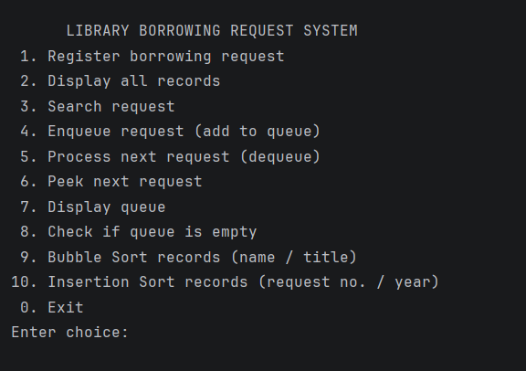

*The main menu showing all available operations.*


### 2. Adding and Displaying Records
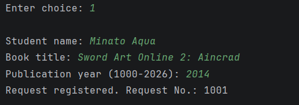

*A request is registered with a student name, book title, and publication year. The system assigns Request No. 1001.*


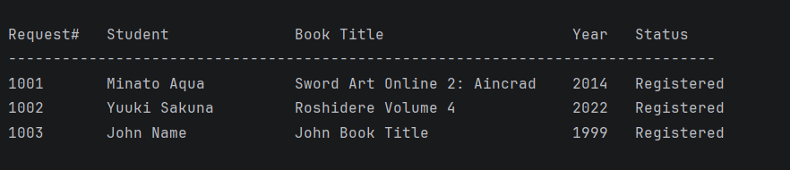

*All stored records with their request number, student, book title, year, and status.*


### 3. Searching for a Request
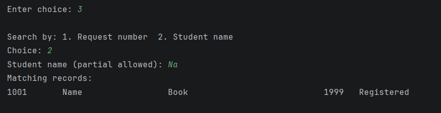

*Searching by student name returns the matching records, and partial names are accepted.*


### 4. Queue Operations
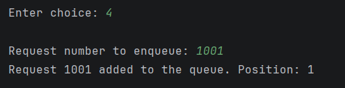
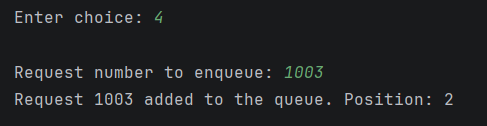
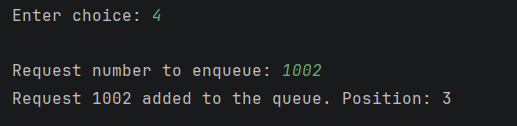

*Requests are enqueued in the order 1001, 1003, 1002. The system reports each one's queue position.*


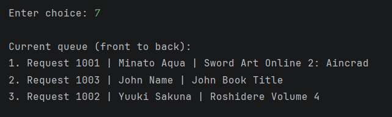

*Display queue shows all three requests from front to back.*


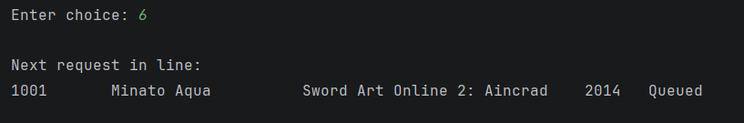

*Peek shows the next request (1001) without removing it.*


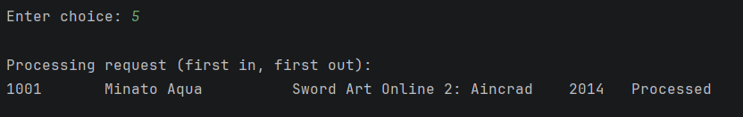

*Process next removes the front request (1001) and marks it Processed.*


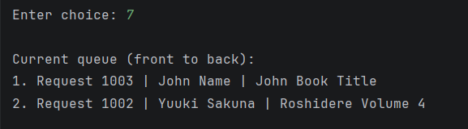

*The queue now holds only 1003 and 1002.*


### 5. FIFO Behavior
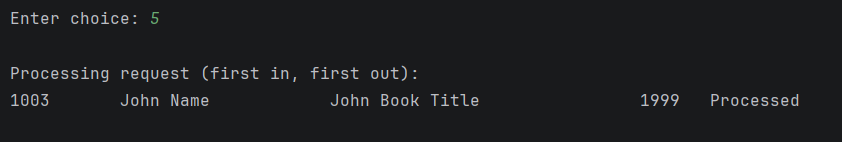
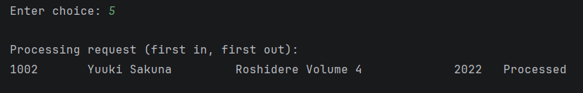

*Requests were enqueued as 1001, 1003, 1002 and processed in that exact order, so the first request added is the first processed.*


### 6. Bubble Sort (Algorithm 1)
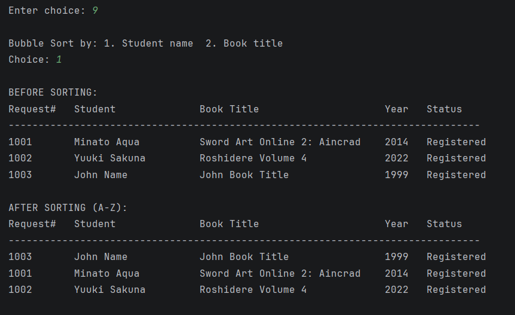

*Records before and after Bubble Sort by student name. The queue order is unchanged.*


### 7. Insertion Sort (Algorithm 2)
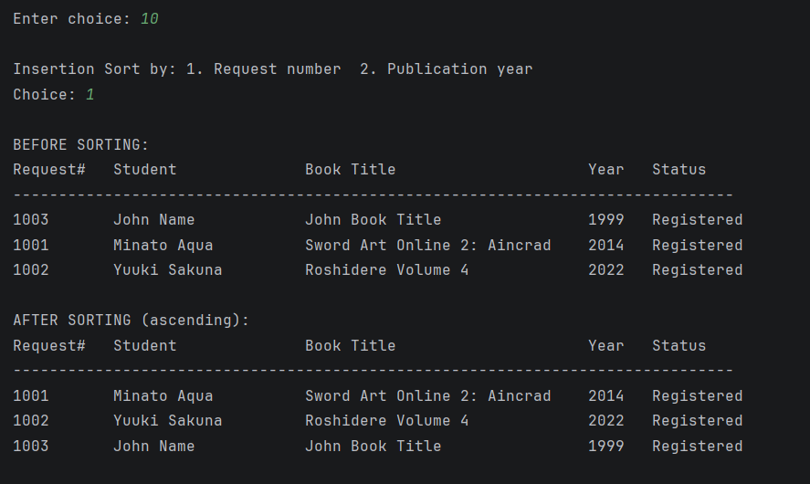

*Records before and after Insertion Sort by request number. The queue order is unchanged.*


### 8. Input Validation and Error Messages
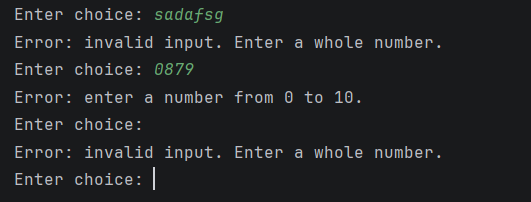

*Non-numeric, out-of-range, and blank menu entries are rejected and the program prompts again.*


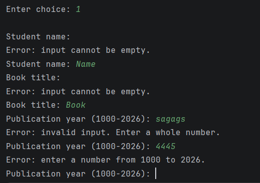

*Blank names and titles, a non numeric year, and an out of range year are all rejected.*


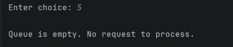

*Processing an empty queue displays a clear message.*


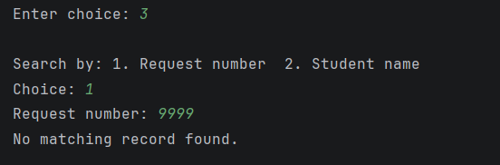

*Searching for a nonexistent request number displays a not found message.*
